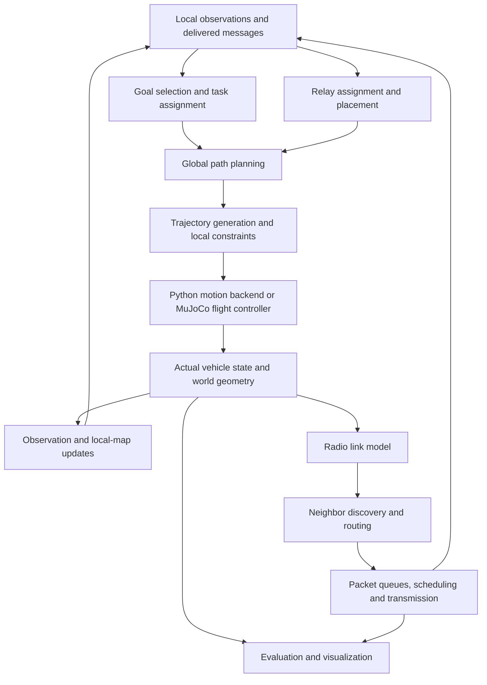

# TAR swarm algorithm stack and build specification

This document captures the algorithm stack agreed in the project specification
and follow-up discussion. It is the starting point for implementation planning.
Build one milestone at a time, measure its behavior, and review the results
before moving to the next milestone.

**Current status:** Step 0 flight simulation is implemented. The Python algorithm
simulator, communication graph, routing, packet transport, planners, mapping,
and autonomous coordination described below are planned work.

Related documents:

- [Simulation architecture rationale](algorithm_simulation_plan.md)
- [Step 0 physics and controller assumptions](step0_engineering.md)
- [Step 0 delivery and validation](step0_delivery.md)

## 1. Mission and operating roles

The system has three roles:

| Role | Responsibility | Outputs |
|---|---|---|
| Mapping drone | Estimate its pose, build a local map, select or accept exploration goals, navigate, and transmit useful map updates | Local state, coverage/frontiers, planned trajectory, incremental submaps |
| Relay drone | Forward multiple traffic flows and move to useful communication positions | Neighbor/link observations, forwarded packets, relay motion references |
| Ground station | Receive and fuse maps, maintain mission state, and coordinate exploration | Global map, task assignments, mission updates |

Agent IDs and counts are configuration-driven. The intended larger configuration
is two mappers and three relays, but small experiments can start with one mapper
and two relays. The Step 0 demonstration currently uses one mapper and three
relays. No algorithm should assume those particular counts.

## 2. Runtime stack

Goal selection decides **what to do next**. Path planning decides **where to
travel**. Trajectory generation decides **how position should change over time**.
Flight control produces **rotor commands**. Relay placement selects positions;
routing selects packet next hops; scheduling selects the next packet to send.



The networking and motion loops run alongside one another. Local stabilization
must continue when the network is disconnected. Network traffic is not required
to close the low-level flight-control loop.

First validate routing with fixed or scripted positions. First validate relay
placement with a known link model. Couple them after their independent baselines
are understood; a moving relay changes the topology available to routing.

## 3. Simulation strategy

### Python algorithm experiments

Use a deterministic headless Python runner for rapid algorithm development.
Start with scripted positions for graph and routing experiments. Add bounded
kinematics when motion policies need evaluation:

```text
p[k+1] = p[k] + v[k] dt + 0.5 a[k] dt^2
v[k+1] = v[k] + a[k] dt
```

Enforce configured speed and acceleration limits consistently with the position
integration. Include a vehicle-specific clearance radius. A small relay and
the 18-inch-prop mapper must not fit through identical obstacle gaps.

Use shared world YAML with primitive buildings. Navigation can initially use
a fixed-altitude occupancy grid with inflated obstacles; retain 3D positions
for line-of-sight queries. Introduce 2.5D or voxel planning when the experiment
needs altitude choices.

### MuJoCo validation

Reuse the same algorithms with the Step 0 motion backend. Use MuJoCo to evaluate
tracking error, turns, braking, actuator limits, physical clearance, and relay
arrival timing. Compute radio links from the vehicles' actual physical positions.
The radio/packet models remain our own Python code in both backends.

Move selected motion-dependent experiments into MuJoCo after their Python
baselines work. Maintain both backends rather than replacing one with the other.
The kinematic backend is useful for parameter sweeps; MuJoCo checks whether
conclusions survive physical execution.

### Clocks and repeatability

- Use one simulation-time authority, independent of wall time and visualization.
- Separate motion, controller, mission-policy, graph, and observation intervals.
- Record the resolved configuration, seed, runtime versions, and backend.
- Give random subsystems reproducible streams and deterministic event ordering.
- Once packet transport exists, schedule arrivals, transmissions, retries, and
  deadlines as events; preserve timings finer than the motion update interval.
- Specify the order of simultaneous events and whether a packet arriving exactly
  at its deadline counts as on time. Keep these conventions fixed in comparisons.

## 4. Information available to algorithms

Maintain separate truth, local estimates, and remote caches:

| Information | Consumers | Initial assumption |
|---|---|---|
| Actual vehicle state and world truth | Physics, collision checks, radio model, evaluator | Always available internally to the simulator |
| Own pose/velocity estimate | Local flight control, mapping, navigation | Equal to truth initially |
| Local occupancy map | Exploration and local navigation | Fully known for navigation baseline; partial for exploration experiments |
| Remote vehicle/map/link information | Coordination, distributed routing, relay policies | Timestamped cache updated through delivered messages once transport exists |

Centralized algorithms can access global information as an explicitly identified
baseline. A distributed algorithm cannot silently access simulator truth or
another drone's current map. Keep observation time, receipt time, map version,
and validity visible to consumers.

Imperfect information can later be introduced one factor at a time: slower
updates, latency, dropouts, position bias, noise, or slowly varying drift. A
delayed noisy pose model is a robustness experiment, not an implementation of
SLAM. Remote-message staleness and local-estimation error are separate variables.

## 5. Interfaces between layers

The following are **proposed contracts** except where marked as existing. Add
concrete types when their milestone needs them; avoid building unused framework
layers in advance. All positions are meters, times seconds, velocities m/s,
accelerations m/s², forces newtons, and probabilities unitless in [0, 1].

| Contract | Essential data | Produced by / consumed by |
|---|---|---|
| `State` — existing | Position, world linear velocity, body-to-world rotation, body angular velocity | Motion adapter / controller and truth evaluator |
| `Reference` — existing | Desired position, velocity, acceleration, yaw | Trajectory generator / motion backend |
| `AgentObservation` | Agent ID, observation timestamp, own state estimate, local-map version, received-message cache | Observation layer / agent policies |
| `Goal` | Goal ID, owning agent, target region/position, creation/expiry time, priority | Mission policy / path planner |
| `PathResult` | Status, ordered points, map version, clearance assumptions, cost | Path planner / trajectory generator |
| `LinkSnapshot` | Node pair, observation time, directional delivery probabilities, LOS/availability, ETX | Link model or estimator / graph and routing |
| `RouteResult` | Destination, ordered path or next hop, topology version, cost, status | Router / packet forwarding |
| `Packet` | Packet/flow IDs, source, destination, class, size, creation time, deadline, hop limit, fragment metadata | Traffic source / queues and transport |
| `SubmapUpdate` | Mapper/submap IDs, version/base version, local frame, timestamp, payload, transform information | Local mapping / network and map fusion |
| `MissionStatus` | Operating mode, assigned tasks, available agents, disconnections and recovery events | Coordinator / agent policies and evaluator |

Interfaces must report failures explicitly: unreachable goal, stale input,
missing route, expired packet, missing map delta, or infeasible relay target.
High-level planning outputs `Reference` values; only the MuJoCo adapter/controller
handles rotor actuators. Core planners and network algorithms do not import
MuJoCo.

## 6. Build order and milestone definitions

The runtime stack is not the implementation order. Networking can be tested
with scripted motion before autonomous exploration exists. The agreed sequence
is Steps 0–12 below.

### Step 0 — Physical flight baseline: implemented

- **Baseline:** component-based mapper and relay models; cascaded position and
  attitude PD control; timed waypoint references.
- **Evidence:** deterministic hover/waypoint demonstrations, actual state and
  command logs, controller plots, and physical acceptance tests.
- **Existing boundary:** `control/interfaces.py`, `control/cascaded.py`, and
  `mujoco/flight.py`. `mujoco/controller.py` currently remains a placeholder.
- **Limitations:** ideal state feedback, provisional hardware parameters,
  instantaneous rotor forces, and no autonomous mission/network algorithms.

### Step 1 — Communication graph and link quality

- **Input/output:** actual node positions, active-node flags, geometry, and link
  parameters produce a timestamped graph and per-link quality.
- **Baseline:** configured distance eligibility and line-of-sight obstruction,
  with separate forward and reverse delivery probabilities.
- **Cost:** `ETX(i,j) = 1 / (P_forward * P_reverse)`. Under the initial independent
  attempt/acknowledgment abstraction, it estimates transmission attempts.
  A zero probability makes the link unusable; never divide by zero.
- **Convention:** retaining directional probabilities does not make their
  product asymmetric. Shared forward/reverse probabilities produce symmetric
  ETX; directed data/ACK models would need separately defined probabilities.
- **Tests:** connected/disconnected graphs, distance changes, LOS blockers,
  asymmetric probabilities, zero delivery, and failed nodes.
- **Plots:** graph overlay, per-link probability/ETX curves, ground-station
  reachability, connected components, and outage intervals.
- **Extensions:** probe-based estimates, path loss, RSSI/SNR, interference,
  contention, and measured radio parameters. Model probabilities are not
  measured link estimates. Toy range/capacity settings remain uncalibrated.

### Step 2 — Multi-hop routing

- **Input/output:** available topology and link costs produce route/next-hop
  decisions and explicit no-route results.
- **Baseline:** centralized ETX-weighted Dijkstra, minimizing summed path ETX.
- **Implementation:** expose the search and tie-breaking logic. Use standard
  data structures; avoid hiding the learning objective inside a graph-library call.
- **Tests:** hand-calculated route costs, competing routes, disconnection,
  invalid/infinite edges, equal-cost ties, and topology changes.
- **Plots/metrics:** selected paths, hop count, cost, route changes, and response
  to link failure. Packet latency/delivery metrics require Step 3 transport.
- **Extensions:** distributed discovery, link-state/distance-vector routing,
  hysteresis, convergence, and congestion-aware costs.

### Step 3 — Packet forwarding, queues, and scheduling

- **Baseline:** finite-capacity transport with bounded queues and FIFO.
- **Traffic classes:** P0 critical network signaling; P1 movement/time-sensitive
  commands; P2 coordination, poses, frontiers, and network state; P3 bulk maps.
- **Comparison:** FIFO versus strict priority versus priority for urgent traffic
  combined with Deficit Round Robin for bulk flows.
- **Required mechanisms:** per-flow queues, timestamps/deadlines, retry limits,
  hop limits, admission/drop policies, fragmentation/reassembly, and concurrent
  mapper flows.
- **Radio abstraction:** finite airtime shared by configured contenders.
  Transmission time includes payload size/capacity and configured overhead.
  Declare half-duplex and interference-domain assumptions. Priority cannot
  interrupt a frame already in transmission. Do not give every simultaneous
  link the entire radio capacity independently.
- **Tests:** buffer overflow, expired packets, retries, packet loss, reassembly,
  cyclic forwarding protection, shared-radio contention, and bulk starvation.
- **Plots/metrics:** mean/P95/P99 latency by traffic class, deadline misses,
  delivered application goodput, drops, queue occupancy, fairness, and map-transfer
  completion time. Report delivered/lost counts alongside latency statistics.
- **Constraint:** bulk traffic and network failure must not stop local stabilization.

### Step 4 — World representation and global navigation

- **Baseline:** assigned goals on a known fixed-altitude occupancy map, obstacle
  inflation, and A* using `f(n) = g(n) + h(n)`.
- **Assumptions:** Euclidean heuristic with compatible movement costs; check
  diagonal transitions to prevent cutting through occupied corners.
- **Output:** geometric path or explicit unreachable status. Smoothing must
  retain clearance; geometric paths are not automatically feasible trajectories.
- **Tests:** blocked/unreachable goals, map boundaries, vehicle-specific gaps,
  diagonal corners, path costs, changed maps, and safe smoothing.
- **Plots/metrics:** occupancy/search expansion, route, clearance, nodes expanded,
  planning time, path length, and replanning behavior.
- **Extensions:** partial maps, 2.5D/3D planning, and multi-agent collision checks.

### Step 5 — Relay assignment and placement

- **Baseline sequence:** static relays; equally spaced chain; dynamic
  distance-based placement; connectivity-aware placement.
- **Inputs:** ground station, mapper positions/predictions, link estimates,
  obstacles, available relays, and movement limits.
- **Outputs:** relay target positions and agent-to-target assignment, followed
  by navigation/trajectory generation.
- **Assignment:** minimum-cost bipartite matching; Hungarian assignment is the
  initial centralized reference when multiple targets/relays exist.
- **Constraints:** speed, acceleration, vehicle clearance, agent separation,
  link availability, limited relay count, and declared movement/energy proxies.
- **Tests:** relay shortages, obstructed targets, assignment ties, infeasible
  formations, mapper movement, and disconnection during repositioning.
- **Plots/metrics:** actual/desired relay positions, routes/links, reachability,
  ETX, transition outages, travel, and goodput once transport exists.
- **Extensions:** Steiner-tree-inspired placement, candidate optimization,
  algebraic connectivity, and traffic-aware placement. A connected final formation
  is insufficient if connectivity is lost throughout its transition.

### Step 6 — Feasible trajectories and MPC

- **Baseline:** existing PD tracking with smooth bounded references; add
  explicit speed/acceleration checks to Python motion experiments.
- **Model:** begin with the translational position/velocity equations in Section 3.
- **Improvement:** receding-horizon MPC with tracking/control cost and movement,
  obstacle, inter-agent, and eventually connectivity constraints.
- **Failure behavior:** detect solver failure/infeasibility and retain a defined
  safe local fallback rather than silently applying an invalid plan.
- **Tests/metrics:** tracking, prediction, constraint violations, solver status,
  computation time, and controller saturation.
- **Visualization:** planned/actual motion, predicted horizon, obstacles,
  constraint boundaries, and control commands.
- **MuJoCo gate:** compare physical tracking and clearance against the simpler
  translational model. Do not present the current PD controller as MPC.

### Step 7 — Local mapping, pose estimation, and submaps

- **Baseline:** ground-truth poses to isolate incremental mapping behavior.
  A geometric visibility/reveal model can test partial-map algorithms, with its
  assumptions explicitly identified.
- **Interfaces:** separate pose estimates from observations; local maps retain
  local reference frames, versions, timestamps, and incremental updates.
- **Development:** occupancy updates, keyframes/submaps, compression, then pose
  uncertainty and realistic sensor/SLAM integration.
- **Sensor constraint:** preserve the downward LiDAR mounting; do not invent
  verified Unitree scan geometry or describe a reveal model as real LiDAR/SLAM.
- **Tests/plots:** map growth, coordinate transforms, occupancy updates,
  incomplete observations, update versions, completeness/error, payload volume,
  compression ratio, and mapping time.

### Step 8 — Global map fusion

- **Baseline:** known simulated transforms, with `p_global = T_global_local p_local`.
- **Mechanisms:** versioned submap exchange, global occupancy fusion, delayed
  and out-of-order handling, duplicate detection, and map synchronization.
- **Transport:** send useful deltas/submaps; declare how a missing base version
  is recovered rather than applying an incompatible update.
- **Tests/plots:** local/global overlays, transform consistency, duplicate/stale
  updates, missing deltas, transfer failures, synchronization delay, and bandwidth.
- **Extensions:** ICP registration, inter-robot loop closures, pose graphs, and
  transform uncertainty. Known transforms do not constitute estimated alignment.

### Step 9 — Exploration goals, task allocation, and overlap

- **Baseline:** frontier detection/clustering and nearest-frontier selection
  on a partial occupancy map.
- **Multi-mapper baseline:** centralized Hungarian task assignment, reservations,
  expiry/reassignment, and explicit no-frontier/no-task results.
- **Improvement:** compare information gain, travel cost, overlap, and connectivity
  risk terms. Normalize quantities before combining unlike units in a score.
- **Constraints:** reachable goals, agent separation, stale maps, and deliberate
  overlap where registration requires it. Ground-station assignments reflect the
  map and information it has actually received in networked experiments.
- **Tests/plots:** unreachable frontiers, competing assignments, stale/expired
  reservations, coverage partitioning, redundant overlap, travel, coverage rate,
  and time to explore a fixed area.
- **Extensions:** auctions, consensus-based bundles, and distributed assignment.
  Exploration behavior can be studied before a full SLAM pipeline exists.

### Step 10 — Joint network-aware exploration and relay control

- **Baseline:** independently designed exploration, relay, and routing policies.
- **Hierarchy:** mission/tasks → topology requirements → relay targets → local
  trajectories → flight control.
- **Coupling:** use mapper trajectory predictions, link risk, queue backlog,
  delivered map throughput, and control deadlines in higher-level decisions.
- **Comparison:** independent policies; connectivity-aware relays; traffic-aware
  relays; predictive connectivity-aware motion.
- **Metrics:** coverage, delivered useful map data, map age, latency tails,
  outages, relay motion/energy proxies, and control constraints.
- **Tests:** cases where improving geometric coverage worsens delivered map data,
  congestion despite connectivity, and prediction errors during relay movement.

### Step 11 — Resilience and recovery

- **Failures:** lost relays, disconnected mappers, interference, congestion,
  wrong link estimates, localization uncertainty, obstruction, and battery limits
  once a corresponding model exists.
- **States:** normal, degraded, recovery, disconnected, and safe local behavior.
- **Requirements:** bounded retry/recovery behavior, explicit stale-information
  handling, and continued local flight stability without the network.
- **Tests/plots:** seeded failure schedules, operating-state transitions, route
  recovery, task reassignment, recovery time, and mission degradation.
- **Comparison:** recovery policy against a defined no-recovery baseline.

### Step 12 — Gazebo/PX4 and hardware transition

Introduce PX4 SITL, Gazebo, ROS 2, MAVLink/MAVROS, measured sensors, real radio
networking, and flight-controller interfaces only after the relevant simulation
stages are validated. Preserve simulator-independent planning/networking code.
Bench-test VoCore throughput, forwarding load, power, firmware/driver support,
and RF behavior. Simulation success, radio compatibility, electrical readiness,
and physical flight readiness are separate validation gates.

## 7. Repository ownership

Use the current repository rather than introducing another top-level project.
The following mapping is planned; names for new files can change during design.

| Location | Responsibility | Status |
|---|---|---|
| `src/tar_swarm/common/` | Shared IDs, geometry, configuration, observations | Config loader exists; drone/world modules are placeholders |
| `src/tar_swarm/simulation/` | Shared experiment clock, scripted motion, bounded kinematic backend | Proposed new package |
| `src/tar_swarm/network/` | Link model, graphs, discovery, routing, packets, scheduling | Existing placeholders |
| `src/tar_swarm/planning/` | Occupancy navigation, A*, trajectory constraints | Proposed new package |
| `src/tar_swarm/mapping/` | Coverage, occupancy/frontiers, submaps and fusion | Existing placeholders |
| `src/tar_swarm/strategies/` | Mapper goals, fixed/greedy relays, assignments and mission policies | Existing placeholders |
| `src/tar_swarm/control/` | Motion references, flight-controller interface and control algorithms | Step 0 baseline exists |
| `src/tar_swarm/mujoco/` | Physical backend and overlays | Step 0 adapter exists |
| `src/tar_swarm/metrics/` | Mission/network/coverage metric definitions | Existing placeholder |
| `src/tar_swarm/evaluation/` | Logs, reports and plotting from measured runs | Step 0 support exists; extend as needed |
| `configs/scenarios/`, `experiments/`, `scripts/`, `tests/` | Experiment inputs, outputs, entry points and validation | Scaffold exists; algorithm experiments are planned |

Avoid duplicate metric definitions in `metrics` and `evaluation`: define the
quantity once, then let evaluation generate reports and plots. Keep config,
world geometry, and results portable between the two motion backends.

## 8. First build: Step 1 checklist

Step 1 is the next implementation task when separately requested. Its scope is
the graph/link model plus a Python experiment and MuJoCo adapter/overlay.

1. Define node IDs/roles, timestamped position snapshots, directional link data,
   and graph availability semantics. Specify whether failed nodes are retained
   as inactive or removed; test that choice consistently.
2. Implement reusable segment-versus-building LOS queries in `common/world.py`.
   Define grazing/boundary behavior and an explicit numerical tolerance.
3. Implement configured distance eligibility and delivery probabilities in
   `network/radio.py`. Validate probabilities and clearly label toy parameters.
4. Implement graph snapshots in `network/graph.py`, including valid ETX and
   unusable links, without imports from MuJoCo.
5. Implement reachability/components in `network/connectivity.py`. Reachability
   is permitted here; weighted route selection belongs to Step 2.
6. Add a small headless scripted-motion runner and scenario YAML. Agent counts,
   positions, trajectories, geometry, link parameters, intervals, and seed are
   configurable. Existing placeholder scenario files are not complete experiments.
7. Exercise static connectivity, mapper movement beyond a usable link, LOS
   blockage, asymmetric delivery, and a failed relay.
8. Save position/link/reachability logs, resolved config, probability/ETX graphs,
   and connectivity/outage plots. Use actual runner output for every result.
9. Feed Step 0 MuJoCo position snapshots into the same graph code and add network
   edges to the viewer. Graph logic remains unchanged across backends.
10. Write a results/limitations note before advancing to routing.

Step 1 acceptance is based on small cases with known answers:

- An unobstructed configured neighbor pair yields the expected probabilities.
- Probabilities 0.8 forward and 0.5 reverse yield ETX 2.5.
- Zero delivery yields an unusable link without NaN or division failure.
- A blocker changes LOS/link availability under the declared obstruction model.
- Reachability changes correctly with motion or a failed relay.
- Identical scripted configuration/seed produces identical results in the tested
  environment. Graphs match across adapters for identical input positions;
  physically tracked MuJoCo paths can produce different positions and links.
- Python headless runs and MuJoCo overlays both produce reviewable output.
- The report does not claim packet latency or goodput from graph connectivity.

## 9. Definition of done for every milestone

Deliver a problem formulation, explicit information/physical assumptions,
baseline, readable implementation, unit/integration tests, at least one useful
visualization, quantitative plots from actual simulation, reproducible config
and commands, limitations, and a baseline comparison where meaningful.

Report what improved, what failed, and which assumptions drive the result.
Evaluate both nominal and targeted failure cases. A visual demo alone is not
algorithm validation; neither is a favorable metric computed with information
the tested policy should not possess. Keep new milestone implementation gated
by a separate instruction so each design remains reviewable.
